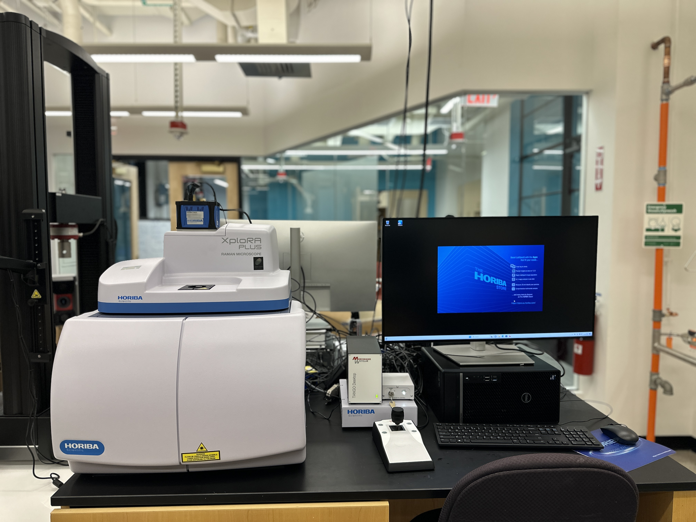

# Horiba XploRA Confocal Raman Microscope

## Overview

The Horiba XploRA is a confocal Raman microscope: it combines an optical microscope with a Raman spectrometer, so you can focus on a specific spot of a sample and collect a spectrum that helps identify what it is made of. It works on solids, powders, liquids, and gases, and is especially useful for organics, polymers, and many inorganic compounds.

The Breakerspace system is configured with three lasers (532 nm, 638 nm, and 785 nm) and four diffraction gratings (600, 1200, 1800, and 2400 grooves/mm), which let you trade off signal strength, spectral resolution, and fluorescence to suit different samples.

This page is the operating page for the Raman microscope. It combines the quick reference for trained users, detailed training notes, reservation link, manuals, and exercises.

## Quick Actions {#quick-actions}

<section markdown="1">
### Get started

* [New to the Raman microscope? Register for training](https://breakerspace.libcal.com/calendar?cid=19408&t=w&d=0000-00-00&cal=19408&ct=69558&inc=0)
* [Reserve time on the Raman microscope](https://breakerspace.libcal.com/seat/174794)
* [Operating the Raman now? Follow the standard operating protocol](#sop)
* [Learn the complete operating workflow](#standard-workflow)
* [Find a weak or missing Raman signal](#weak-signal)
* [Reduce fluorescence and prevent saturation](#fluorescence)
</section>
<section markdown="1">
### Learn and reference

* [Learn what Raman spectroscopy can show you](#science)
* [Improve spectral resolution](#spectral-resolution)
* [Choose a laser and grating](#laser-grating)
* [Choose the confocal hole and slit](#choosing-the-confocal-hole-and-slit)
* [Locate the LabSpec 6 main controls](#main-controls)
* [Map measurements across an area](#mapping)
* [Measure depth in a clear sample with confocal z-depth profiling](#z-profiling)
* [Analyze and process your data](#data)
* [Try the practice exercises](#exercises)
</section>

## Compatible Materials And Sample Prep {#materials}

* All materials must be non-hazardous and safe to handle in the Breakerspace.
* The instrument can measure solids, powders, liquids, and gases.
* It works well for organics, polymers, acids and bases, metal oxides, and semiconductors.
* It is not useful for metals, ionic salts such as NaCl, or strongly fluorescing materials.

<em>If you have any questions about whether a material is appropriate to characterize in the Breakerspace, please ask before bringing it to the lab.</em>

### Sample Prep

* Place the sample on a glass microscope slide.
* The objectives have a short working distance, so grind powders finely and keep the surface level and smooth.
* For a solid without a flat face, mount it to the slide with the sample press and Plastilina mounting clay to create a stable surface to focus on.

## Standard Operating Protocol {#sop}

<strong>Alignment notice — November 18, 2026.</strong> The laser/detector alignment is currently imperfect. The laser hits the sample slightly above and to the left of the crosshair center. With the enclosure closed and the laser on, use the <strong>internal camera</strong> to identify the brightest part of the actual laser spot. Position your intended measurement area at that spot and optimize focus there, rather than at the crosshair. Then refine focus against the Raman peaks in RTD.

### Instrument Startup {#startup}

* Log on to the instrument workstation using your MIT Kerberos.
* Open the LabSpec 6 software.
* Confirm the instrument is powered on. It should always be left powered on.
* Turn the laser emission remote-control power to on if needed. This enables the lasers but does not fire one.

### Operation {#operation}

* Prepare your sample on a glass microscope slide (see [compatible materials and sample prep](#materials)).
* Lower the microscope stage with the coarse focus knob.
* Load the slide into the slide holder on the stage and switch to the **external (top) camera**.
* Choose brightfield or darkfield viewing, whichever shows your sample more clearly, and adjust **White light level** for a clear camera image.
* Find approximate focus with the coarse knob.
* Refine the focus by rotating the joystick, continuing to adjust **White light level** as needed to avoid washing out the view.
* Close the doors on the microscope enclosure and confirm the interlocks.
* Stop the external camera view, switch to the **internal camera**, and turn on the laser.
* Refine focus to make the actual laser spot as small and clear as possible, following the [alignment notice](#alignment-notice).
* Stop the camera view, start **RTD**, and refine focus against the Raman peaks.
* Collect Raman spectra as appropriate for your sample (see [detailed operating instructions](#details)).
* Repeat as needed.

### Instrument Shutdown {#shutdown}

* Remove your sample from the stage and close the doors.
* Turn the laser emission remote-control power to off.
* Save all data. Each spectrum must be selected and saved individually.
* Close LabSpec 6.
* Log off the workstation.

## Laser And Grating Selection {#laser-grating}

Choosing the laser and grating is the heart of getting a good Raman spectrum. The tables below summarize the trade-offs explained in the [detailed instructions](#details).

| Laser | Relative photon energy | When to use it |
| --- | --- | --- |
| 638&nbsp;nm | Medium | Recommended starting point for most samples. |
| 532&nbsp;nm | Highest | Switch to it when you need a stronger signal or better signal-to-noise, but avoid it for temperature-sensitive, dark, or delicate samples that could burn. |
| 785&nbsp;nm | Lowest | Try it for fluorescence that persists with visible excitation. Re-find Raman focus: it can differ noticeably from camera focus and visible-laser focus. |

| Grating (gr/mm) | Resolution / signal strength | Note |
| --- | --- | --- |
| 600 | Lower / higher | The CCD usually captures the whole spectrum in one position; good for a first look. |
| 1200 | Medium / medium | A balance between resolution and signal. |
| 1800 / 2400 | Higher / lower | May need the grating repositioned five or more times to capture the full spectrum. |

## Detailed Operating Instructions {#details}

Start with the [standard workflow](#standard-workflow) to calibrate and collect. If peaks are weak or missing, follow [finding a weak signal](#weak-signal); if a broad background or clipped spectrum dominates, follow [reducing fluorescence and preventing saturation](#fluorescence). Once usable peaks are visible, [improve spectral resolution](#spectral-resolution) only as needed.

### Standard Workflow {#standard-workflow}

This is the recommended sequence for a normal session: calibrate the instrument against a silicon standard, then load and measure your own sample. The pattern of "get a camera image, verify the laser, look at a live spectrum, optimize focus for signal" repeats for both the calibration sample and your real sample.

<figure class="page-figure raman-main-controls" id="main-controls">
  <a class="raman-image-link" href="{{ '/assets/img/tutorials/raman/raman-main-controls.png' | relative_url }}" target="_blank" rel="noopener" aria-label="Open the full-resolution LabSpec 6 main-controls image in a new tab">
    
  </a>
  <figcaption><strong>LabSpec 6 main controls.</strong> Control locations; displayed values are examples. <a href="{{ '/assets/img/tutorials/raman/raman-main-controls.png' | relative_url }}" target="_blank" rel="noopener">Open full-resolution image (new tab)</a>.</figcaption>
</figure>

A key habit throughout: **before starting another function, use the ["stop all" control](#main-controls) to stop anything that is currently running.** This includes camera video, the real-time display (RTD), or an acquisition. Start the next function only after the current one has stopped.

**A note on objectives.** The system has 5x, 10x, and 100x objectives. Use the **5x for wayfinding only** — it is handy for locating a feature on the sample, but it is not high enough magnification to collect a Raman signal. Use the **10x for general Raman measurements**. Reserve the **100x for identifying specific small particles or similarly small features**. The 100x has a very short working distance: take extra care when positioning and focusing to avoid colliding with the sample. Check clearance before switching objectives or moving the stage, and approach focus carefully. Whichever objective you use, select the matching objective in the software (Acquisition > Instrument Setup), because the software needs to know which one is in place.

**Camera viewing.** Choose **<a href='{{ "/instruments/raman-acquisition-controls.html" | relative_url }}#video' target="_blank" rel="noopener" aria-label="brightfield or darkfield — annotated Acquisition panel (opens in a new tab)">brightfield or darkfield</a>** according to the sample and which view makes its features easiest to see. Adjust **White light level** for a clear image, and readjust as you approach focus; the maximum setting usually washes out the view. When checking the laser spot in the internal camera, keep the image clear enough to distinguish its brightest region. Apparent brightness in the camera is not a measure of laser power at the sample; use the ND filter setting to adjust laser power.

#### Part 1: Calibrate With The Silicon Standard

Calibrating against a silicon sample first confirms the instrument is reading the correct Raman shift before you trust any data from your own sample. Silicon has a strong, well-known peak (near 520 cm-1), which makes it the standard reference.

1. **Load the silicon calibration sample** on the stage.
2. **Focus with the <a href='{{ "/instruments/raman-acquisition-controls.html" | relative_url }}#video' target="_blank" rel="noopener" aria-label="external (top) camera — annotated Acquisition panel (opens in a new tab)">external (top) camera</a>** using the 10x objective for routine calibration. The top camera gives better resolution for a sharp optical focus on the surface. You can use the 5x to find your way first, then switch to the objective you will use for collection.
3. **Close the enclosure doors and confirm the interlocks are satisfied.** The laser will not fire unless the enclosure and interlock conditions are correct.
4. **Stop the external camera view, switch to the internal camera, and turn on the laser.** Locate the brightest part of the actual spot, slightly above and left of the crosshair under the [current alignment condition](#alignment-notice). Target that spot rather than the crosshair, and refine focus to make it as small and clear as possible. This is an initial focus check; optimize against Raman peaks in RTD afterward. If no laser is visible, recheck the documented door, interlock, and key conditions rather than bypassing anything.
5. **Stop the camera** view.
6. **Start the [real-time display (RTD)](#main-controls)** to show a quick, continuously refreshing spectrum. Use a short RTD acquisition time (around 1 second) so the display updates quickly, and set the spectro (the center of the spectral window) where you expect the silicon peak.
7. **Refine focus for Raman collection using the joystick knob.** Make small focus adjustments and watch whether the signal goes up or down; focus to maximize the signal. The best camera focus and Raman focus can differ, especially at 785 nm; use the [fine-focus search](#raman-focus) after every laser change.
8. **Stop the RTD.**
9. **Run the AutoCalibration routine** (in the Maintenance tab).
10. **Verify the calibration passes** before continuing. If it does not pass, ask staff rather than proceeding.

<em>Note: system AutoAlignment is handled by Breakerspace staff and is done for each laser before it is used. If your calibration will not pass, or a laser seems misaligned, ask staff rather than adjusting alignment yourself.</em>

#### Part 2: Load And Measure Your Sample

With calibration confirmed, measure your own sample using the same get-image / verify-laser / live-spectrum / optimize-focus pattern. **If anything is still running, use "stop all" before starting the next function**, whether you are switching from camera video, RTD, or an acquisition.

1. **Lower the stage** and remove the silicon sample.
2. **Load your sample** (see [sample prep](#materials)).
3. **Focus with the external (top) camera.** Use the 5x to locate your feature if helpful, then use the 10x for general collection. Use the 100x when targeting specific small particles, taking extra care with its very short working distance to avoid sample collisions. Select the matching objective in the software.
4. **Close the enclosure doors and confirm the interlocks.**
5. **Stop the external camera view, switch to the internal camera, and turn on the laser.** Verify it appears on the sample (re-check the interlocks if it does not). Position the intended measurement region at the brightest part of the actual laser spot, following the [alignment notice](#alignment-notice), and refine focus to make the spot as small and clear as possible. Optimize against Raman peaks in RTD afterward.
6. **Stop the camera view and start RTD** to see a live spectrum, and confirm the spectro position covers the wavenumber range where you expect key peaks.
7. **Optimize the focus for signal** with the joystick knob, using the [fine-focus search](#raman-focus), especially at 785 nm. If peaks are missing, follow [finding a weak signal](#weak-signal); if background dominates, follow the [fluorescence guide](#fluorescence). Then stop the RTD.
8. **Set up and run your sample collection.** Configure the collection parameters below for your goal and start the measurement.

#### Collection Parameters

**<a href='{{ "/instruments/raman-acquisition-controls.html" | relative_url }}' target="_blank" rel="noopener" aria-label="View the annotated Acquisition panel (opens in a new tab)">View the annotated Acquisition panel</a>** (opens in a new tab)

See the complete panel, with section links for camera, timing, spectrum, mapping, and hole/slit controls.

RTD is only for checking and optimizing the setup; it does not average spectra. When you are ready to record real data, use the full spectrum acquisition, which averages multiple accumulations over your chosen range. The parameters that matter most:

* **Spectro / spectral range:** the spectro value sets the center of a single detector window; hovering over the box shows the window's width. For a wider spectrum than one window covers, enable the extended **<a href='{{ "/instruments/raman-acquisition-controls.html" | relative_url }}#acquisition-parameters' target="_blank" rel="noopener" aria-label="Range — annotated Acquisition panel (opens in a new tab)">Range</a>** option and enter start and stop values, and the instrument will step the grating through as many positions as needed to cover it.
* **<a href='{{ "/instruments/raman-acquisition-controls.html" | relative_url }}#spectrum' target="_blank" rel="noopener" aria-label="Acquisition (exposure) time — annotated Acquisition panel (opens in a new tab)">Acquisition (exposure) time</a>:** how long the detector collects for each spectrum. Longer times give more signal and better signal-to-noise, but take longer. Two practical checks: the signal-to-noise should be good enough to see your peaks clearly, and the maximum intensity should stay below about 65,000 counts (above that the detector saturates).
* **<a href='{{ "/instruments/raman-acquisition-controls.html" | relative_url }}#spectrum' target="_blank" rel="noopener" aria-label="Accumulations — annotated Acquisition panel (opens in a new tab)">Accumulations</a>:** how many spectra are averaged together. More accumulations improve signal-to-noise and let the software reject cosmic-ray spikes, at the cost of time.
* **Number of spectra / positions:** because a Raman spectrum comes from a tiny spot, measuring several spots is often worthwhile for a non-uniform sample.
* **Confocal hole and slit:** the hole controls depth selection; the slit controls spectral resolution. Smaller openings can reduce useful Raman counts. Start with generous collection settings to find a spectrum, then adjust one control at a time (see [choosing the confocal hole and slit](#choosing-the-confocal-hole-and-slit)).
* **[ND filter (laser power)](#main-controls):** reduces the laser power reaching the sample. Lower the power for delicate, dark, or temperature-sensitive samples; watch the live spectrum to confirm the sample is not being burned (a spectrum that keeps changing during exposure is a warning sign).

Start conservative on exposure time and laser power for an unfamiliar or delicate sample, check the result, then increase if you need more signal. If you are unsure what settings suit your sample, ask staff.

### Finding A Weak Or Missing Raman Signal {#weak-signal}

Use this sequence after the silicon calibration passes. Change one setting at a time and wait for a complete new RTD exposure before judging it. Look for identifiable Raman peaks above the local background and noise; higher total counts alone may just mean more fluorescence.

1. **Check the signal path and target.** Use the 10x for general measurements, or the 100x for a specific small particle with careful attention to sample clearance. Select the matching objective in Acquisition → Instrument Setup. Close the enclosure and confirm the interlocks. In the internal camera with the laser on, place the intended sample region at the brightest part of the actual laser spot, following the [current alignment notice](#alignment-notice). Use “stop all” to stop any active function before starting another, including when switching between camera video and RTD.
2. **Begin with efficient collection and low illumination.** Start with **638 nm, the 600 gr/mm grating, a 500 µm hole and a 200 µm slit**, unless the sample calls for another laser. Select a low transmitted-power percentage with the ND filter. A lower transmission percentage means less light at the sample; use the trained low-power setting appropriate to the material, not an assumed universally safe percentage. Keep dark, delicate and laser-sensitive materials, including iron oxides, at low power.
3. **Put the expected peaks in the detector window.** Set Spectro to a region expected to contain Raman bands. Start with a short RTD exposure, around **1 second**, and shorten it if the signal approaches saturation. A spectrum outside the expected range can look empty even when collection works.
4. **Search for Raman focus.** Follow the [fine-focus procedure below](#raman-focus). Do this before concluding that a laser gives no signal, particularly at **785 nm**, and repeat it whenever you change laser, objective or measurement position.
5. **Increase illumination cautiously if peaks remain weak.** With collection and focus optimized and no saturation or sample change, move to the next higher available transmission percentage, wait for a fresh exposure, and compare the peaks. Stop increasing when the result is usable. If the spectrum changes persistently, the sample discolors, or background rises without useful peaks, stop exposure and lower power; ask staff if damage is suspected. Do not jump directly to full power.
6. **Choose the next laser from what you see.** For weak peaks on a low background, try **532 nm** only if the material tolerates it. For a broad fluorescent background, use the [fluorescence guide](#fluorescence) to try a longer wavelength. Stop acquisition before switching lasers, return to low transmitted power, confirm calibration for the selected laser using the standard workflow, and find its Raman focus again. Equal filter percentages on different lasers do not imply equal power at the sample.
7. **Collect longer once the setup works.** Increase exposure only while individual spectra remain unsaturated and the sample stays stable. Use saved acquisitions with multiple accumulations for better signal-to-noise; RTD does not average accumulations. Save the raw spectrum and the settings used.
8. **If there are still no peaks, check the sample and system separately.** Try another representative spot, confirm that the laser is on the sample rather than the slide or mounting clay, and recheck the silicon standard with the selected laser. If the standard fails, ask staff. If the standard works but the sample does not, ask about sample suitability or another method rather than continuing to raise power.

#### Finding Raman Focus, Especially At 785 nm {#raman-focus}

**A sharp microscope image is only a starting point.** The best Raman focus can differ from the visible camera focus and from the best focus for another laser. Wavelength-dependent focal shift (chromatic focal shift) is especially important with the **785 nm near-infrared laser** on this instrument: its best Raman focus can be noticeably displaced from the microscope view and the visible-laser focus. There is no single offset or direction to apply to every objective and sample.

785 nm has the lowest photon energy of the three lasers and generally produces weaker Raman scattering than visible excitation. That makes careful focus especially valuable when finding a weak signal; lower photon energy does not mean the sample cannot heat or burn.

1. Find the sample in the top camera, then use the internal camera with the enclosure closed and laser on to locate the actual brightest laser spot. Target that location, following the [alignment notice](#alignment-notice).
2. Stop the camera and start RTD with a window covering expected peaks. Keep laser power, exposure, hole, slit and grating fixed while comparing focus positions.
3. Use the joystick fine-focus knob to make small Z adjustments. Wait at least one complete exposure at each position. Search on both sides of the initial camera focus while maintaining safe objective-to-sample clearance; do not make large blind stage movements or continue toward contact.
4. Compare the Raman peak height above its local background, using fixed display scaling or numerical counts. When the peaks weaken, reverse direction and use smaller adjustments around the best position. Do not optimize on a broad fluorescent background alone.
5. Keep the focus that gives the clearest Raman peaks, even if the camera image would look less sharp there. Repeat after every laser change, especially when switching to 785 nm. If no peak becomes visible within safe fine-focus travel, return to the weak-signal sequence or ask staff; do not keep moving the stage blindly.

### Reducing Fluorescence And Preventing Saturation {#fluorescence}

A broad, sloping background often indicates fluorescence. A flat-topped or clipped signal near the detector limit indicates saturation; strong Raman peaks can also saturate. First restore an unsaturated measurement, then judge whether fluorescence is hiding the peaks.

**Wavelength and power solve different problems.** Moving from **532 → 638 → 785 nm** lowers the energy per photon and may avoid absorption that excites fluorescence. The ND filter lowers the number of photons reaching the sample without changing their energy. Lower power usually lowers both Raman and fluorescence, so it can prevent saturation without improving their ratio. The available lasers are three discrete choices: there is no continuously adjustable setting that guarantees “just below” a sample's fluorescence threshold.

1. **Recover from saturation first.** Stop acquisition. Reduce the transmitted laser power and shorten the exposure, then restart. Keep the highest counts comfortably below the approximately **65,000-count** limit, including the background and any strong peaks. Check numerical counts; automatic display scaling can hide the problem. A clipped spectrum must be reacquired.
2. **Try the next longer available wavelength.** If using 532 nm, try 638 nm; if fluorescence remains at 638 nm, try 785 nm. Start each laser at low transmitted power and short exposure. Confirm calibration for that laser through the standard workflow. A sample already known to fluoresce strongly with visible light can start at 785 nm.
3. **Find the new Raman focus before comparing lasers.** Use the actual laser spot and [fine-focus search](#raman-focus), particularly at 785 nm. Keeping the visible-laser focus can make a successful reduction in fluorescence look like a loss of all signal.
4. **Recover measurable Raman peaks cautiously.** Begin with the 600 gr/mm grating, 500 µm hole and 200 µm slit. At the selected wavelength, step transmitted power up only while the sample remains stable and each exposure remains unsaturated. Then extend exposure or save multiple accumulations as appropriate. Choose the laser that gives the clearest useful peaks above background and noise, not simply the lowest background or the highest counts.
5. **Check where the background comes from.** Make sure the measurement spot is on the intended material rather than the slide, clay or contamination. Try another representative location. If unwanted light comes from outside the focal region, reduce the hole **500 → 300 → 100 µm** with the slit fixed, recheck focus, and compare peak contrast. This may help reject out-of-focus background; it does not remove fluorescence originating in the same sampled region.
6. **Use unsaturated acquisitions for averaging.** If exposure time is limited by background, use more short, unsaturated accumulations instead of one saturated long exposure. Averaging can improve signal-to-noise, but it cannot recover clipped data or guarantee visible peaks beneath strong fluorescence. Baseline subtraction is for usable spectra; it does not undo saturation or remove fluorescence shot noise.
7. **Stop when the trade-off no longer works.** If 785 nm still gives overwhelming fluorescence or no identifiable peaks after refocusing and careful collection optimization, ask staff about another method, such as FTIR. Do not try to burn away fluorescence with prolonged or high-power illumination.

For the optical trade-offs, see [HORIBA's laser-wavelength guidance](https://www.horiba.com/usa/scientific/technologies/raman-imaging-and-spectroscopy/raman-spectrometer-presentation/) and [Edinburgh Instruments' fluorescence technical note](https://www.edinst.com/resource/technical-note-how-to-reduce-fluorescence-in-raman-spectroscopy/).

### Improving Spectral Resolution After Finding Peaks {#spectral-resolution}

1. **Save a usable starting spectrum and its settings.** Decide which nearby bands you need to distinguish. Broad intrinsic bands may remain broad regardless of instrument settings.
2. **Try a finer grating.** Move from **600 to 1200 gr/mm**, then consider **1800 or 2400 gr/mm** if the extra separation is useful. Recenter the detector window on the bands of interest; a finer grating covers less spectral range at once.
3. **Try a narrower slit with the grating and hole fixed.** Reduce **200 → 100 → 50 µm**, comparing peak separation and width at each step. Keep position, focus, laser power and exposure unchanged for the initial comparison.
4. **Keep only changes that help.** If resolution improves but counts fall, collect longer or use more accumulations while keeping the sample stable and individual exposures unsaturated. Stop narrowing when lost signal outweighs useful separation. Keep the hole generous unless you also need [depth selection or rejection of out-of-focus background](#choosing-the-confocal-hole-and-slit); it is not interchangeable with the slit.

### Choosing A Laser

The system includes three lasers: 532 nm, 638 nm, and 785 nm. Shorter wavelengths have higher photon energy and generally produce stronger Raman scattering. Sample absorption and power at the focused spot also matter: any of the lasers can heat or damage a sample. Longer wavelengths often reduce fluorescence, but the response depends on the material.

A practical approach is to start with the 638 nm laser. Move to 532 nm if you need a stronger signal or better signal-to-noise. If you see fluorescence, follow the [longer-wavelength comparison](#fluorescence). Re-optimize [Raman focus](#raman-focus) after every laser change, especially at 785 nm.

### Choosing A Grating {#choosing-a-grating}

Scattered light must be spread out by a diffraction grating before the detector can measure its intensity at each wavelength. The system has four gratings: 600, 1200, 1800, and 2400 grooves/mm.

A coarser grating (600 gr/mm) spreads the light less, so more signal lands on the detector at once: higher signal strength but lower resolution, and closely spaced peaks can merge. Finer gratings spread the light more, giving higher resolution at the cost of signal strength.

Finer gratings also produce a [wider dispersion](https://www.dropbox.com/scl/fi/0kcumhfxxhycy8b47l32d/Raman-Spectral-Resolution-Tech-Note.pdf?rlkey=321k53nqc9jn6cdqkqhpb0rzd&st=dr66nh85&dl=0) than the CCD detector chip is wide. The instrument handles this by moving the grating to aim different segments of the spectrum onto the detector in turn. With an 1800 or 2400 gr/mm grating you may need five or more grating positions to capture a full spectrum, whereas the 600 gr/mm grating usually captures it in a single position.

### Choosing the Confocal Hole and Slit {#choosing-the-confocal-hole-and-slit}

The confocal hole and spectrometer slit control how much returning light reaches the detector and what information can be distinguished. For an unfamiliar sample with weak or absent peaks, begin with generous collection settings. Once a spectrum is visible, reduce either aperture only when the improvement is useful.

| Control | Available settings | Effect of reducing the opening |
| --- | --- | --- |
| Confocal hole | 500, 300, 100 µm | Rejects more light from outside the focal region, improving depth selection and potentially reducing unwanted background. Useful Raman counts may decrease. |
| Spectrometer slit | 200, 100, 50 µm | Can improve spectral resolution, helping distinguish nearby bands and reducing instrumental broadening. Useful Raman counts may decrease. |

These controls interact: their effects also depend on the objective, optical image size, grating and wavelength. Changing a setting does not guarantee a proportional change in signal or resolution.

#### First, find a spectrum

For initial signal finding, try a **500 µm hole and 200 µm slit**. These are the largest available openings and a practical starting point for weak signals and uneven powders, rather than a universal optimum.

Choose an appropriate spectral window and [optimize focus against the Raman peaks](#raman-focus), especially after switching to 785 nm. Only the region illuminated by the laser needs to be targeted; the whole camera field does not need to appear sharply focused. Opening the confocal hole does not sharpen the camera image or illuminate a larger field.

A wider aperture may collect additional substrate signal or fluorescence along with the desired Raman light. Judge success by identifiable peaks above the local background and noise, not by total counts alone.

#### Then, improve the information you need

Choose the appropriate adjustment rather than reducing both controls together:

* **For better depth selection:** keep the slit fixed initially and reduce the hole from **500 → 300 → 100 µm**. Compare spectra at different Z positions. The smaller hole can help distinguish layers in a transparent or translucent sample, at the expense of counts.
* **For better spectral resolution:** keep the hole fixed initially and reduce the slit from **200 → 100 → 50 µm**. Check whether nearby bands separate or measured peaks become narrower enough to help interpretation.

Stop reducing an aperture when the loss of signal outweighs the useful improvement. Intrinsically broad bands will not necessarily become sharp with a narrower slit. Longer collection may recover signal-to-noise if the sample remains stable.

The hole diameter is an internal aperture dimension, not the thickness of the sampled layer. Actual depth resolution depends on the objective and sample optics. Closing the hole also does not enable measurement through an opaque particle.

#### Compare settings fairly

Use <a href='{{ "/instruments/raman-acquisition-controls.html" | relative_url }}#instrument-setup' target="_blank" rel="noopener" aria-label="Acquisition → Instrument Setup — annotated Acquisition panel (opens in a new tab)">Acquisition → Instrument Setup</a> to select Hole and Slit. If the controls remain enabled during RTD, change one setting at a time and wait for the mechanism to settle and at least one complete new exposure. If the controls are disabled or the update is not applied, stop RTD, change the setting and restart.

Keep the measurement position, focus, laser power, exposure time and grating unchanged during each initial comparison. Use fixed display scaling or numerical counts so automatic rescaling does not hide intensity changes. Recheck Raman focus afterward, particularly with a smaller hole.

RTD does not average accumulations. If the differences are difficult to judge, save acquisitions at each setting using the same exposure and accumulation count.

Opening the hole or slit changes collection, not laser power at the sample. This is especially useful when working with laser-sensitive materials such as iron oxides: optimize collection before increasing illumination.

### AutoFocus {#autofocus}

LabSpec 6 includes an <a href='{{ "/instruments/raman-acquisition-controls.html" | relative_url }}#acquisition-parameters' target="_blank" rel="noopener" aria-label="AutoFocus function — annotated Acquisition panel (opens in a new tab)">AutoFocus function</a> that steps the focus through a range, watches the signal, and settles at the position that maximizes it. It can help on samples where manual focusing is difficult or unreliable, such as highly polished or featureless surfaces, and it can hold focus across a rough surface during a map.

AutoFocus is slow, however, because it collects signal at many focus positions. **We do not recommend it as a default focusing method.** For a normal measurement, focus manually with the joystick against the live RTD spectrum (see the [standard workflow](#standard-workflow)). Reach for AutoFocus only when manual focus is not possible or not reliable.

### Mapping And Area Scanning {#mapping}

Instead of a single spectrum from one spot, the XploRA can collect a grid of spectra across an area and build a map showing how the material varies from place to place. This is how you turn Raman into a chemical image: for example, showing where each active ingredient sits across a combination tablet, or where a contaminant is distributed on a surface.

To set up a map:

1. Acquire a video image of the region you want to map so you can see the area. (For an area larger than one field of view, the video Montage function can stitch several frames together.)
2. In the **<a href='{{ "/instruments/raman-acquisition-controls.html" | relative_url }}#map' target="_blank" rel="noopener" aria-label="Map — annotated Acquisition panel (opens in a new tab)">Map</a>** section of the Acquisition tab, choose the variables to scan: X and Y for a surface area, Z for depth (see below), or combinations.
3. Set the **step size** between points. Smaller steps give finer detail but many more points.
4. Choose the map area and shape with the map tools (rectangle, circle, line, or a set of chosen points).
5. Set acquisition parameters as for a single spectrum, but keep in mind that a map collects one spectrum per point and can involve hundreds or thousands of points. Favor a single spectral window and shorter per-point acquisition times to keep the total time reasonable.

Because a map can run for a long time, estimate the total time (points times per-point time) before you start. If the sample surface is rough, [AutoFocus](#autofocus) can keep each point in focus during the map, though it adds time.

### Confocal Z-Depth Profiling {#z-profiling}

Confocal Z-profiling uses the confocal hole to collect spectra at different depths *within* a transparent or translucent sample, rather than only at the surface. It is what lets Raman act like a non-destructive optical "core sample."

**How it works.** A confocal hole (pinhole) sits in the Raman signal path at a plane matched to the focal point. Closing the hole down blocks Raman light coming from above and below the focal plane, so the spectrometer sees mostly the light from the thin layer you are focused on. By stepping the focus deeper (a Z scan) and collecting a spectrum at each depth, you build a depth profile. Remember that this confocality applies to the Raman signal only, not to the optical camera image.

**Why do it.** It is ideal for samples that change with depth: multilayer polymer films, coatings, inclusions inside a transparent matrix, or a material measured through a transparent cover. A confocal depth profile can show where one layer ends and the next begins without physically sectioning the sample.

**How to set it up.**

* Once a spectrum is visible, keep the slit fixed initially and reduce the confocal hole from **500 → 300 → 100 µm**, comparing spectra at different Z positions (see [choosing the confocal hole and slit](#choosing-the-confocal-hole-and-slit)). A smaller hole can improve depth selection at the cost of useful Raman counts; its diameter is not the thickness of the sampled layer.
* Set up a **Z** map (or an XYZ map) in the Map section, with a Z step size suited to the layer thickness you expect.
* Expect the signal to fall off as you focus deeper, because the light passes through more material and the focal volume distorts. This is normal; the objective choice affects how severe it is.
* For quantitative depth measurements, plan the objective, hole size, and step size with staff; actual depth resolution depends on the objective and sample optics.

<em>Closing the confocal hole does not enable measurement through an opaque particle.</em>

## Data Processing And Analysis {#data}

Spectra are collected and saved in LabSpec 6 (see the [Save data control](#main-controls)). Remember that each spectrum must be selected and saved individually before you close the software.

Typical processing steps include:

* **Baseline correction:** subtract the sloping background (often from residual fluorescence) so the true peaks stand out.
* **Peak identification:** note the positions of the main peaks in Raman shift (cm-1), which are the basis for identification.
* **Comparison and matching:** compare your peaks against reference spectra, a database, or a known control. As with other fingerprint methods, a good match lines up several peaks, not just one.
* **Export:** save both the raw spectrum and any processed version, and keep a copy on your own storage.

For a browser-based introduction to viewing and processing Raman spectra, visit the [Data Exploration Tools]({{ "/data-tools/" | relative_url }}) page.

Data processing beyond these basics is best learned at the instrument; please ask lab staff if you have questions about analysis or database searching.

## Common Failure Modes {#failures}

| Symptom | Likely cause | What to try |
| --- | --- | --- |
| Cameras do not connect to the software | Software or camera communication issue | Restart the workstation, then reopen LabSpec 6. |
| No spectrum at all | Laser is not actually on | Confirm the laser is firing using the internal camera view. |
| No spectrum, signal seems out of range | Spectrometer position is outside the displayed range | Reposition the spectrometer to cover the expected wavenumber range. |
| No identifiable peaks, just a large broad hump | Fluorescence is overwhelming the Raman signal | Follow [reducing fluorescence and preventing saturation](#fluorescence): recover an unsaturated signal, try a longer wavelength, and re-find Raman focus. |
| Weak signal | Camera focus differs from Raman focus, target misses the actual laser spot, restrictive collection settings, or unsuitable laser/grating | Follow [finding a weak signal](#weak-signal), including the actual-spot check and the 785 nm fine-focus search. |
| Flat-topped or clipped spectrum near 65,000 counts | Detector saturation from background or strong peaks | Stop, lower transmitted power and shorten exposure, then reacquire; follow the [saturation guide](#fluorescence). |
| Sample looks damaged after measurement | Laser burned a temperature-sensitive sample | Use a longer-wavelength laser and lower power; ask staff about power settings. |

## What This Instrument Shows You {#science}

### The Basic Idea

Raman spectroscopy identifies materials by how their molecules vibrate. When you shine a laser on a sample, almost all the light bounces off unchanged, but a tiny fraction exchanges a little energy with the molecule's vibrating bonds and comes back at slightly shifted wavelengths. Measuring those small shifts produces a spectrum with peaks at characteristic positions, a molecular "fingerprint" that often identifies a compound outright.

Because the XploRA is a *microscope*, you aim that laser through an objective lens at a specific spot, often just a few micrometers across. You can see the sample on screen, pick the exact feature you care about, and collect a spectrum from that point.

It is also a *confocal* Raman microscope, but with an important detail: the confocality applies only to the Raman signal path, not to the optical camera image. A confocal hole in the Raman path rejects light from above and below the focal plane, which lets the instrument probe specific depths within a transparent or layered sample. The optical microscope image itself is not confocal, so what you see on the camera is a normal (widefield) view.

Raman is often described as complementary to FTIR. Both probe molecular vibrations, but they respond to different kinds of bonds, so a feature that is weak in one is frequently strong in the other. A material that is difficult in the FTIR may be straightforward in the Raman, and vice versa.

### What Scientists Use It For

* A chemist or materials scientist can identify an unknown solid, powder, or liquid by matching its Raman fingerprint to reference spectra.
* A pharmaceutical scientist can tell apart the active ingredients in a combination tablet, and even map where each is distributed across the surface.
* A geologist or gemologist can identify minerals and gemstones nondestructively, without cutting or dissolving the sample.
* An art conservator or forensic examiner can identify pigments, inks, fibers, or residues from a tiny spot without damaging the object.
* A semiconductor or 2D-materials researcher can measure strain, layer number, and quality in materials such as silicon, diamond, and graphene.
* A curious student can compare everyday plastics (is this container PET, HDPE, or polystyrene?), check whether two white powders are actually the same thing, or probe the layers of a snack-bag film.

### What To Look For In The Results

Start with the peak positions. Raman peaks are plotted against "Raman shift" in wavenumbers (cm-1), and their positions are the primary fingerprint. Matching that pattern of positions against reference spectra is how compounds are identified, and a good match lines up several peaks rather than one.

Watch for a broad, sloping background swamping the peaks. That usually means fluorescence, where the sample re-emits light far more strongly than it Raman-scatters. It is the most common reason a Raman measurement fails, and the usual fix is a longer-wavelength laser (see [laser and grating selection](#laser-grating)).

Finally, judge peak sharpness and signal strength against your settings. Sharp, well-separated peaks may need a finer grating to resolve; a weak signal may need a shorter-wavelength laser or longer collection. The [detailed instructions](#details) explain these trade-offs.

### What This Instrument Cannot Tell You

* It does not work well on metals, which do not produce a useful Raman signal, or on simple ionic salts such as NaCl.
* Strongly fluorescing materials can overwhelm the Raman signal entirely; if a sample still fluoresces with the 785 nm laser, it may simply not be suitable.
* It reports which molecules or bonds are present, not a full quantitative composition by default.
* It samples a tiny spot. That is powerful for targeting a feature, but it means one spectrum may not represent a non-uniform sample; sample several spots.
* Higher-energy lasers can heat or burn delicate, dark, or temperature-sensitive samples, so the "strongest signal" setting is not always safe to use.

## Exercises {#exercises}

* **Level 1 - System check and routine spectrum:** Load the silicon calibration sample; focus with TopCam; close the enclosure doors and confirm the interlocks; focus with the internal camera and laser; use RTD with small focus adjustments to optimize counts; and run AutoCalibration to verify system function. Then load a compatible sample, repeat the applicable focus and RTD checks, collect a routine spectrum with trained settings, and save the result.
* **Level 2 - Laser and grating comparison:** Collect a spectrum from one sample using different laser and grating combinations. Describe how each choice changed signal strength, resolution, and fluorescence.
* **Level 2 - Combination-tablet mapping:** Perform a spatial map on an [aspirin/paracetamol/caffeine tablet](https://en.wikipedia.org/wiki/Aspirin/paracetamol/caffeine) and identify the different compounds present.
* **Level 3 - Confocal depth profiling:** Use the confocal capability to collect spectra at different depths within a layered material, such as a snack-bag film, and identify the layers.
* **Level 3 - Fluorescence troubleshooting:** Take a sample that fluoresces under the 532 nm laser and work through the laser choices to recover a usable Raman spectrum, or determine that the sample is not suitable.

## Manufacturer Manuals {#manuals}

* [LabSpec 6 general use quick-start guide](../assets/img/tutorials/raman/LabSpec6-General-Use-Quick-Start-Guide.pdf)
* [LabSpec 6 AutoFocus quick-start guide](../assets/img/tutorials/raman/LabSpec6-AutoFocus-Quick-Start-Guide.pdf)
* [The importance of confocality (Horiba technical note RA-TN 15)](../assets/img/tutorials/raman/RA-TN15-Importance-of-Confocality.pdf)
* [Slit width, pixel size and spectral resolution (Andor)](https://andor.oxinst.com/learning/view/article/slit-width-pixel-size-and-spectral-resolution)
* [Raman spectral resolution technical note (grating dispersion)](https://www.dropbox.com/scl/fi/0kcumhfxxhycy8b47l32d/Raman-Spectral-Resolution-Tech-Note.pdf?rlkey=321k53nqc9jn6cdqkqhpb0rzd&st=dr66nh85&dl=0)
* [Full Horiba XploRA and LabSpec 6 documentation folder:](https://www.dropbox.com/scl/fo/ppao3nkalsx14dyhnlryo/ADc_wEUGXbfb9_MfXPeQ9PM?rlkey=3xm38dmwhua13nhfar3ffepjl&dl=0) additional manuals, reference guides, and Horiba application notes.

## Links {#links}

* [Horiba: what is Raman spectroscopy?](https://www.horiba.com/int/scientific/technologies/raman-imaging-and-spectroscopy/raman-spectroscopy/)
* [Horiba XploRA PLUS product page](https://www.horiba.com/int/scientific/products/detail/action/show/Product/xplora-plus-1528/)
